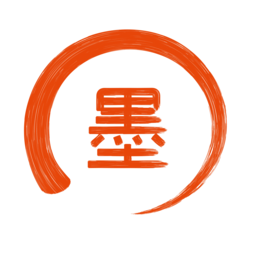

<p align="center">
  
</p>

<h1 align="center">Nodosumi</h1>

<p align="center">
  <b>A Dreamcast emulator tuned for H700 handhelds</b>
</p>

<p align="center">
  <a href="#features">Features</a> •
  <a href="#how-its-built">How it's built</a> •
  <a href="#installation">Installation</a> •
  <a href="#building">Building</a>
</p>

---

## Features

- **Full speed on an H700** — AArch64 JIT tuned for the Cortex-A53
- **libretro core and desktop app** — the desktop app runs on Linux, macOS, and Windows
- **Save states** — byte-exact, and they survive between sessions
- **Multi-disc** — `.m3u` playlists with RetroArch disk control
- **Formats** — `.cdi`, `.chd`, `.gdi`, `.cue`, `.m3u`

## How it's built

Nodosumi is written in C and descends from [Redream](https://github.com/inolen/redream).

| Part | What it does |
|------|--------------|
| `src/guest` | The Dreamcast: SH-4, ARM7, PowerVR2, AICA audio, GD-ROM, Maple input, BIOS/flash |
| `src/jit` | Recompiler: SH-4 and ARM7 frontends → IR → optimization passes → x86-64 or AArch64 backend, with an interpreter fallback |
| `src/render` | PowerVR2 renderer on OpenGL ES 3.0 |
| `src/host` | Frontends: libretro (`retro_host.c`) and SDL2 (`sdl_host.c`) |

## Installation

1. Copy `nodosumi_libretro.so` to RetroArch's `cores/` and `libretro/nodosumi_libretro.info` to `info/`
2. Put your Dreamcast BIOS at `<system>/dc/boot.bin`

## Building

Needs CMake 3.5+, Ninja, and `aarch64-linux-gnu-gcc` for the H700 build.

### libretro core for H700

```bash
cmake -S . -B build -G Ninja \
  -DBUILD_LIBRETRO=ON \
  -DA64_JIT=ON \
  -DCMAKE_TOOLCHAIN_FILE=cmake/aarch64-linux.cmake \
  -DCMAKE_BUILD_TYPE=Release
cmake --build build
```

### Desktop app

```bash
cmake -S . -B build -G Ninja -DCMAKE_BUILD_TYPE=Release
cmake --build build
```

## License

GPLv3 or later. Credits are in [COPYRIGHT.md](COPYRIGHT.md).

SEGA and Dreamcast are trademarks of SEGA Corporation. Nodosumi isn't affiliated with SEGA.
